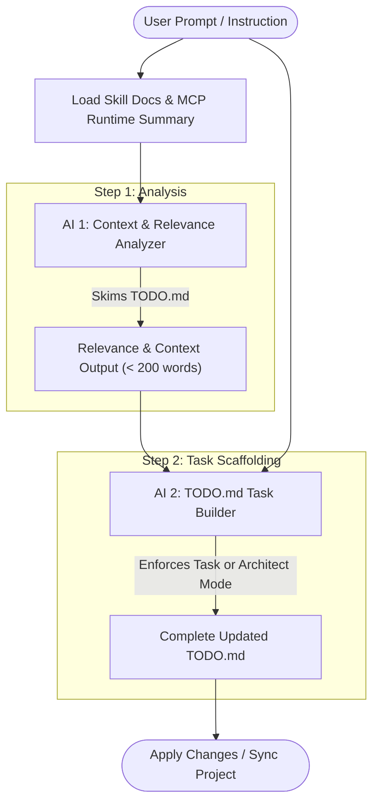

# Ergo AI Step Logic & Workflow Architecture

This document details the step-by-step logic, data flow, context boundaries, and agent handoffs for both core AI pipelines in Ergo:
1. **The Human AI Assistant Pipeline** (`runHumanAiAssistant`) — Workspace drafting and task structuring.
2. **The Task Execution Pipeline** (`executeTaskWithAi`) — The 3-stage execution engine invoked when running a task.

---

## 1. Human AI Assistant Pipeline (`runHumanAiAssistant`)

The Human AI Assistant uses a **2-agent sequential pipeline** to translate user intent into the human task list (`TODO.md`), following the core principle: **Human-Side First**. It writes no overviews: a task's working brief is written by the Summary step of its first run, from the task, its related tasks and the project's memory.



### Modes of Operation
- **Task Mode (Default):** Strict single-task isolation. Fleshes out one selected or newly created task with concrete domain subtasks without touching or reordering any other tasks in `TODO.md`.
- **Architect Mode:** Broad roadmap planning. Assumes a higher-level scope, generating or reorganizing multiple categories, tasks, and sequential milestones.

---

### Step 1: AI 1 — Context & Relevance Analyzer (`assistant-context-analyzer`)
- **Role:** Fast, read-only reconnaissance.
- **Model Target:** Discovery model (e.g. `gpt-4o-mini`, `claude-3-5-haiku`, `gemini-2.5-flash`, or `llama3.2`).
- **Inputs & Context:**
  - Full current `TODO.md` content.
  - Active MCP connections list and allowed directory boundaries (`getAllowedRoots`).
  - Dedicated skill instructions (`skills/assistant-context-analyzer/SKILL.md`).
  - The raw user prompt.
- **Execution Logic:**
  - Scans categories, task numbers, existing subtasks, and briefs to identify structural patterns to mirror.
  - Identifies the target category and computes next task numbers.
  - Identifies relevant connected MCP tools that can help fulfill the task.
- **Output:** A strict, concise brief (< 200 words) detailing relevance, target category, numbering, constraints, and tool candidates.

---

### Step 2: AI 2 — TODO.md Task Builder (`assistant-todo-builder`)
- **Role:** Crafts the human-facing task list in native markdown.
- **Model Target:** Primary/General model (e.g. `gpt-4o`, `claude-3-7-sonnet`, `gemini-1.5-pro`, `qwen2.5-coder`).
- **Inputs & Context:**
  - Current `TODO.md`.
  - User prompt + AI 1 Context & Relevance Analysis.
  - Dedicated skill instructions (`skills/assistant-todo-builder/SKILL.md`).
- **Execution Logic:**
  - Implements **Human-Side First**: Full functional details and subtasks live in `TODO.md`.
  - Applies strict formatting: 4-space indented subtasks (`    - `), numbered lists restarting per category (`1.`, `2.`), markdown headings (`## Category`), and `~~` strikethroughs for done items.
  - Strictly prevents generic filler subtasks (e.g., forbids *"Research and plan..."* in favor of concrete domain steps).
- **Output:** The complete updated `TODO.md` document inside a fenced code block (`markdown:TODO.md`).

---

## 2. Task Execution Pipeline (`executeTaskWithAi`)

When a user clicks **Run Task** on an individual task item (without an active CLI PTY agent), Ergo initiates the **4-stage execution pipeline**.

```mermaid
flowchart TD
    RunTask([Run Task Triggered]) --> Step1[Step 1: Discovery AI]
    
    subgraph Discovery [Step 1: Context Relevance Scan & Baseline Markdown Context]
        Step1 -->|Ingests Task Header Index only| HeaderIndex["Task Header Index (Active + Archived)"]
        HeaderIndex --> RelevanceJson["JSON: { relevantTaskIds }"]
        RelevanceJson --> FullContext["Baseline Markdown Context:\n- Target Task & Subtasks\n- Pointers & Context Snippets\n- Connected MCPs"]
    end
    
    FullContext --> Step2[Step 2: Summary AI / task-brief]
    
    subgraph Synthesis [Step 2: Overview & Markdown Bible Synthesis]
        Step2 -->|Synthesizes full context into Markdown| OverviewDoc["Working Brief:\n- Goal / Scope / Known context\n- Constraints\n- Done when (strict checklist)\n- Filtered Required MCPs"]
    end
    
    OverviewDoc --> Step3[Step 3: Manager AI / manager-agent]
    
    subgraph Execution [Step 3: Task Execution & Puzzle Piece Assembly]
        Step3 -->|Ingests Structured Markdown Bible| BiblePrompt["Markdown Bible Prompt (TASK_CONTEXT.md):\n- Metadata & Task Checklist\n- Working Brief (verbatim)\n- Run Environment & Active MCPs\n- Append-Only Event Log"]
        BiblePrompt --> ProviderBranch{Provider Engine}
        ProviderBranch -->|Anthropic / OpenAI / Gemini| ToolLoop[Native MCP Tool Call Loop\n(Max 8 Rounds)]
        ProviderBranch -->|Ollama with Tool Calling| ToolLoop
        ProviderBranch -->|Ollama without Tool Calling| WorkerPattern[Ollama Worker AI Pattern\nPlan -> Worker AIs -> Synthesis]
        ToolLoop --> ManagerSummary[Manager Output & Assembled Solution]
        WorkerPattern --> ManagerSummary
    end

    ManagerSummary --> Step4[Step 4: Logger AI]
    
    subgraph Logging [Step 4: Completion Record]
        Step4 -->|JSON Schema Prompt| FinalJson["JSON:\n{ buildAndVerification, completion, humanReview }"]
        FinalJson --> Persist["Mark Task DONE\nSave Build & Completion to the task brief (RUNNING_JOBS.json)"]
    end
```

---

### Step 1: Discovery AI (Context Relevance Scan & Baseline Markdown Assembly)
- **Objective:** Find applicable knowledge from other workspace tasks (including completed and archived tasks) without reading the entire repository or dumping full context documents.
- **Token Efficiency Safeguards:**
  - Uses a lightweight/fast model (`gpt-4o-mini`, `gemini-2.5-flash`, `claude-3-5-haiku`, `llama3.2`) for fast context acquisition.
  - Skims only the lightweight **Task Header Index** containing `#N. Title (Category) [ARCHIVED] [DONE]` and truncated overview snippets (~150 chars).
  - Adheres to "pass pointers over payloads" (concise summaries and references rather than raw document dumps).
- **Context Provided:**
  - Task Header Index and target task title, category, and subtasks.
  - Project guideline files (e.g. `AGENTS.md` / `CLAUDE.md`) if present.
- **Execution Logic:**
  - Determines if any prior tasks contain architectural decisions, shared schemas, or dependencies relevant to the current task.
  - Assembles the clean baseline **Markdown Context Document**, cleanly separating the byte-stable prefix (system instructions, schemas, caching anchors) from volatile per-task data.
- **Output:** Identifies relevant task IDs and structures the baseline Markdown context for Step 2.

---

### Step 2: Summary AI (`task-brief` — the Working Brief)
- **Objective:** Fold the task, its selected related tasks and notes, prior knowledge and project guidelines into the **working brief** — the exact spec the manager works from and the spec section of the bible (`TASK_CONTEXT.md`). It also picks the required MCPs, the task kind and the Hardener decision.
- **Format** (`docs/skills/task-brief/SKILL.md`): `Goal`, `Scope` (including what is out of scope), `Known context`, `Constraints`, `Done when`, `Assumptions` — one-line bullets, facts with their source ids, 60–350 words depending on the task.
- **Done when is a strict checklist:** one bullet per behaviour (starting state → action → observable result, exact values from the input), including a failure or edge case where the behaviour has one. Gherkin-formatted criteria were tested and dropped: no measurable gain for the manager, 30% longer, more invented specifics.
- **Master Markdown Bible Document Format:**
  ```markdown
  # TASK EXECUTION BIBLE: User Registration & Validation

  ## Metadata
  - **Task ID**: #1
  - **Category**: Auth
  - **Status**: todo
  - **Source**: TODO.md ("Todo" Lane)
  - **Project**: Default Workspace (/workspace)

  ## Task Checklist
  - [ ] Implement registration form UI
  - [ ] Add input validation rules
  - [ ] Wire auth API handler

  ## Working Brief (the Summary step's spec)
  **Goal:** New users can register with a username, email and password and land on the welcome page.

  **Scope:**
  - Registration form UI, validation rules, auth API handler
  - Out of scope: email verification [#4]

  **Known context:**
  - User schema has username, email, password_hash [#2]

  **Done when:**
  - On the registration page, submitting a valid username, email and password redirects to the welcome page with a confirmation message
  - Submitting an invalid email format shows "Invalid email format" and creates no user

  ## Run Environment
  - **Required MCPs**: Filesystem MCP
  - **Allowed Boundaries**: `/workspace/.ergo`

  ## Execution Event Log (Append-Only)
  - [Progress notes, subagent results, and test diagnostics will be recorded here]
  ```

---

### Step 3: Manager AI (`manager-agent` — Task Execution & Puzzle Piece Assembly)
- **Objective:** Systematically execute the task using connected MCP tools against the structured **Markdown Bible Document (`TASK_CONTEXT.md`)**, directly referencing the working brief's "Done when" criteria to solve every "piece" of the puzzle.
- **The Markdown Bible Document**:
  - The Manager receives the scoped, structured Markdown master blueprint assembled from Discovery and Summary, and treats it as an append-only event log.
- **Criteria Puzzle Piece Decomposition & Accumulation Rule**:
  - **Decomposition**: The Manager decomposes the brief's "Done when" criteria (C1, C2, …) into discrete "puzzle pieces" (`setup` preconditions, `build` implementation, `verify` acceptance checks, `edge` failure and edge cases).
  - **Accumulation Rule**: The Manager is **only finished** with the complete task when it has accumulated all completed pieces of the puzzle and every criterion passes verification.
- **Strict Filesystem Boundaries:**
  - The AI has access **ONLY** to write files within the `.ergo` directory (`~/.ergo`) or folders explicitly permitted under **Connections -> Allowed Folders**.
  - Writing to the app's codebase repository or outside approved boundaries is strictly forbidden and rejected at the MCP host gateway with HTTP 403.
  - All project files, generated scripts, and artifacts live under `.ergo` (`projects/<project-id>/...`) or permitted external folders.
- **Interactive Mid-Build Human Clarification (`ask_human` Tool):**
  - All providers have access to the built-in `ask_human` tool (`{ question: string, options?: string[], context?: string, allowFreeform?: boolean }`).
  - When the Manager AI is missing critical information, credentials, or faces architectural forks, it invokes `ask_human`.
  - **Human Side:** The task card displays an amber, pulsing **Needs Input** indicator badge (`.task-needs-input-badge-pill`) and highlights the card.
  - **AI Side:** `BriefPane` and `ExecutionModal` render a Claude Code-style interactive prompt card (`.ai-human-input-card`) offering selectable option buttons, free-form text input, and Ctrl+Enter keyboard submission.
  - Submitting returns the user's answer directly back to the Manager loop as a tool result and resumes execution.

- **Execution Logic by Provider:**

#### A. Anthropic (`runAnthropicBuilderLoop`)
- Uses Anthropic's native `tool_use` API.
- Converts MCP servers into Anthropic `input_schema` tools, injecting `ask_human`.
- Evaluates tool calls up to 8 conversation rounds. Handles permission prompts (`onRequestPermission`), human clarification prompts (`onRequestHumanInput`), executes via `callMcpTool`, feeds `tool_result` blocks back into the stream, and emits real-time `ExecutionStep` updates to the UI.

#### B. OpenAI (`runOpenAiBuilderLoop`)
- Uses OpenAI function calling (`tools: [{ type: "function", function: ... }]`).
- Loops through `tool_calls` responses, executes tools against local MCP servers or intercepts `ask_human`, and posts back `tool` message roles.

#### C. Gemini (`runGeminiBuilderLoop`)
- Uses Gemini `functionDeclarations` and processes `functionCall` / `functionResponse` part structures.

#### D. Ollama (`runOllamaBuilderLoop` & `runOllamaWorkerPattern`)
- First attempts native OpenAI-compatible tool calling with `ask_human`.
- **Worker AI Fallback:** If the local model does not return tool calls (lacks tool-calling capabilities):
  1. **Plan:** Main AI breaks down the task into a numbered list of concrete work items.
  2. **Workers:** Spawns separate worker AI calls for each work item with task context.
  3. **Synthesis:** Main AI aggregates worker results and outputs a consolidated completion summary.
  4. Flags `usedWorkerPattern = true` so Step 4 can document the lack of direct tool access.

---

### Step 4: Logger AI (Completion Recording, Artifacts, & Human Review Evaluation)
- **Objective:** Generate formal build documentation, list all created/modified files with direct IDE open links, evaluate human review requirements, and save them on the task's brief (RUNNING_JOBS.json) and in `TODO.md`.
- **Inputs & Context:**
  - Current Task metadata, original subtasks, and human review flags.
  - Builder AI's execution summary.
  - Full tool call log and created files list (`builderResult.createdFiles`).
  - Existing Overview.
  - If Ollama worker pattern was used: an automated note explaining the fallback.
- **Execution Logic & Evaluation:**
  - Evaluates whether the user needs to inspect or verify changes at the end (for higher-order/complex tasks, sensitive architectural changes like auth, DB, payments, deletion, or tasks explicitly flagged for human review).
  - Collects all created/modified files and presents them in `createdFiles` and the completion markdown.
  - Returns strict JSON:
    ```json
    {
      "buildAndVerification": "Markdown detailing implementation journey and checks...",
      "completion": "Markdown detailing completion summary, what was built, and list of completed files...",
      "createdFiles": ["projects/sample/src/auth.ts", "projects/sample/README.md"],
      "needsHumanReview": true,
      "humanReviewSteps": ["Verify updated DB schema migrations", "Confirm payment webhook endpoint responds 200 OK"]
    }
    ```
- **Clickable File Links & IDE Integration:**
  - In the `BriefPane` Completion tab, all created files and code artifacts are rendered in an interactive **Completed Work & Created Files** panel.
  - Clicking **"Open in IDE"** directly opens the file in the user's IDE (VS Code, Cursor, or system editor via `POST /api/files/open`).
  - Markdown links to files (`[filename](path)`) in the completion notes can also be clicked to open directly in the user's IDE.
- **Persistence & State Update:**
  - Regular executed subtasks are marked `isDone: true`.
  - Human review subtasks are output as `    - **human review** - <step>` with `isDone: false, isHumanReview: true`.
  - If human review steps exist, task status is set to `'partly_done'` with a dedicated **Human Review** purple badge in `TaskPane` and a verification checklist card in `BriefPane`.
  - If no human review is required, task is marked `'done'` (`isDone: true`).
  - Updates the task's brief with the new `Build & Verification` and `Completion` sections (including human review and artifacts list).
  - Persists both files to local workspace storage and syncs the UI.

---

### Offline / Fallback Execution (`runOfflineExecution`)
When no AI provider is configured (`provider: 'none'` or missing API keys):
- Ergo runs a deterministic step simulator that walks through the 5 UI stages (`Reading Context` → `Executing MCP Tool` → `Executing Subtasks` → `Rendering Widget Preview` → `Updating Markdown Files`).
- Preserves explicit `**human review**` subtasks, triggers simulation for interactive questions when tasks request clarification, and maintains UI responsiveness.
