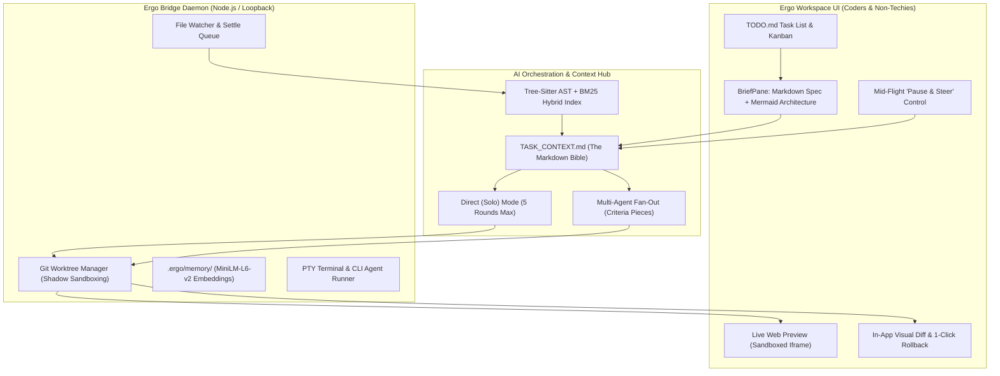

# Ergo: Competitive Audit & AI Implementation Roadmap

> **Document Purpose:** This document serves as an end-to-end technical reference and implementation specification for AI agents and engineers extending Ergo. It documents competitor analysis (Kiro Code, Orca, Clairvoyance), identifies Ergo's current gaps, and provides step-by-step technical blueprints for building the target features.

---

## 1. Architectural Baseline & Ergo's Core Tenets

Ergo is built around three foundational pillars:
1. **Markdown-Steered Dual-Layer Context:**
   - **Human Layer (`TODO.md`):** Clean, terse, scannable markdown task list with subtasks and categories.
   - **AI Layer (`TASK_CONTEXT.md` / Working Brief):** Rich, dependency-ordered technical specification synthesized per task from vector memory, project guidelines (`AGENTS.md` / `CLAUDE.md`), and historical learnings.
2. **Zero-Token Local-First Vector DB & Code Index:**
   - Embeddings computed locally on disk (`.ergo/memory/`) using `all-MiniLM-L6-v2` (384-dim) via the Ergo Bridge.
   - Fast keyword indexing via BM25 in `src/lib/codeIndex/codeIndex.ts`.
   - Surfaces 85%+ of relevant context before spending a single LLM token.
3. **Hybrid Local Daemon (`Ergo Bridge`):**
   - Node-based background daemon (`bridge/plugins.ts` and `src/lib/bridgeClient.ts`) running loopback on `localhost:5173-5180`.
   - Powers filesystem reads/writes, interactive terminal PTYs via WebSockets, local vector DB, and MCP tool execution for both local dev and hosted web deployments (`https://ergo.appwrite.network`).

---

## 2. Competitive Landscape: What the Competition Does Better

### 2.1 Kiro Code (Spec-Driven Agent Development)
* **Core Strength:** Rigorous Spec-Driven Development (SDD) pipeline: `Requirements → Architecture / Design → Implementation Tasks → Automated Verification`.
* **Where Kiro Excels:**
  - **In-App Visual Diffing:** Side-by-side AST and line diffs right in the workspace with hunk-by-hunk acceptance or 1-click full rollback.
  - **Living Architecture:** Architectural contracts (interfaces, data models, call graphs) are written and approved *before* implementation code is generated.
  - **Interactive Human Steering:** Allows the user to pause and inject corrections mid-flight without killing the session.

### 2.2 Orca / OpenHands / Devin (Autonomous Agent Harnesses)
* **Core Strength:** Isolated runtime execution and visual feedback loops.
* **Where Orca Excels:**
  - **Execution Sandboxing (Git Worktrees / Containers):** Code is never executed directly on the user's primary working tree. Tasks run in ephemeral branches or containers; users only merge changes upon passing review.
  - **Live Browser Previews & Visual Validation:** Integrated Playwright/headless browser runs automatically. For frontend deliverables (HTML, React, CSS), the agent captures DOM state and screenshots to verify layout before marking a task complete.
  - **Autonomous PR & Branch Automation:** Converts finished task trees into clean, atomic Git commits with generated PR summaries.

### 2.3 Clairvoyance / Augment Code (Code Knowledge Graphs)
* **Core Strength:** Deep codebase understanding via AST (Abstract Syntax Tree) and LSP (Language Server Protocol).
* **Where Clairvoyance Excels:**
  - **AST-Aware Chunking:** Instead of splitting files by arbitrary line counts (e.g. 30 lines), files are parsed into semantic symbols: function declarations, classes, interfaces, method implementations, and call graphs.
  - **Cross-File Dependency Tracking:** When an API signature changes, Clairvoyance queries the call graph to locate all downstream callers across the entire codebase.

---

## 3. Gap Analysis: Where Ergo Lags Currently

| Capability | Current Ergo Implementation | Limitation / Vulnerability |
| :--- | :--- | :--- |
| **Code Review & Diffs** | Launches external IDE (`vscode`, `sublime`) via `bridge/ideGit.ts` and `src/components/RunChangedFiles.tsx`. | **Critical barrier for non-coders.** Non-techies cannot inspect diffs inside the app or selectively revert bad AI edits without knowing git. |
| **Visual Web Preview** | Files written to disk (e.g. `coin_collector_game.html`). User must manually open files or start dev servers. | **No visual feedback loop.** Neither the human nor the AI can preview rendered web pages or components in-app. |
| **Code Indexing** | Static 30-line chunks (`CHUNK_LINES = 30`) + BM25 + MiniLM in `src/lib/codeIndex/codeIndex.ts`. | **Fragmented context.** Functions, classes, and types are severed mid-definition across chunk boundaries. |
| **Safety & Sandboxing** | Direct mutation of the user's live working directory. Base tree saved in `.ergo/runs/<runId>/git-base.json`. | **High risk.** A failed run or erroneous script can leave dirty uncommitted files or corrupt node_modules. |
| **Mid-Flight Steering** | Run proceeds autonomously until completion or until the model chooses to call `ask_human`. | **Token waste on wrong turns.** If an agent starts off on the wrong track, the user cannot pause and redirect without canceling. |
| **Spec Visualization** | Text-based Markdown working brief in `src/components/BriefPane.tsx`. | **Lacks visual clarity.** Complex systems are described only in text bullets rather than intuitive visual diagrams. |

---

## 4. Target Architecture & Integration Blueprint



---

## 5. Phase-by-Phase Implementation Specifications

### Phase 1: In-App Visual Diff Viewer & 1-Click Rollback

#### Goal
Allow any user (developer or non-coder) to inspect changed files directly inside Ergo with color-coded diffs, accompanied by an instant **"Undo All Changes"** or **"Discard This File"** action.

#### Key Files
- `src/components/RunChangedFiles.tsx` (Extend to include inline diff viewer)
- `src/components/VisualDiffModal.tsx` (New component: split/unified diff view)
- `bridge/ideGit.ts` (Add `revertRunChanges` and `revertFileChange` endpoints)
- `bridge/plugins.ts` (Expose `POST /api/git/revert-run` and `POST /api/git/revert-file`)

#### Detailed Implementation Steps
1. **Bridge Revert Endpoints (`bridge/ideGit.ts`):**
   - Read the existing `git-base.json` snapshot stored at `<cwd>/.ergo/runs/<runId>/git-base.json`.
   - Implement `revertRun(runId: string)`:
     ```typescript
     // Checkout the recorded base tree for all changed files
     execFile('git', ['checkout', baseTreeHash, '--', ...changedFiles], { cwd: repoRoot });
     ```
   - For newly added files (untracked in base tree), cleanly delete them using `fs.unlink`.
2. **Diff Payload Generator:**
   - Add bridge endpoint `GET /api/git/run-diff?runId=...&file=...` that executes `git diff <baseTreeHash> -- <filePath>` and returns standard unified diff text.
3. **Frontend In-App Diff Drawer (`src/components/VisualDiffModal.tsx`):**
   - Render unified or side-by-side diffs using a lightweight CSS-styled diff parser (or Monaco diff editor).
   - Display buttons: `[Discard File]`, `[Revert All Run Changes]`, `[Accept & Keep]`.
   - Display a concise 1-sentence AI summary of *why* each file was changed.

---

### Phase 2: Live Web Preview Sandbox (HTML & Dev Server Apps)

#### Goal
Provide an immediate visual feedback tab in the execution pane so users can test web deliverables (games, components, dashboards) directly inside Ergo without leaving the app.

#### Status: built (bridge protocol 11)
- `bridge/preview.ts`: `POST /api/preview/session` issues an unguessable token for one Allowed Folder. `GET /api/preview/s/<token>/<path>` serves that folder's files, so relative CSS, JS and images load. Every response sends a CSP `sandbox` without allow-same-origin, which means the page can never use the app's or the bridge's origin. HTML responses also get a console relay injected. `GET /api/preview/ports` finds dev servers on common ports and skips Ergo bridges.
- `src/components/LivePreviewPane.tsx` is the **Preview** tab, next to Timeline and Terminal in the task pane's Actions stage. It shows the run's HTML pages, detected dev servers, or a typed `localhost` URL. It has Desktop/Tablet/Mobile widths, Reload and Open in browser. While the task runs, the shown page reloads when its file changes. A console drawer captures output for run pages only, because dev servers are other origins and aren't proxied.
- Changed-file rows (`RunChangedFiles`, `RunTimelineView`) have a Preview button on HTML files.
- Differences from the original sketch below: the frame loads bridge-served files instead of `srcDoc`, because `srcDoc` can't load a page's relative assets. There is no dev-server proxy, and so no console capture for dev servers.

#### Key Files (original sketch)
- `src/components/LivePreviewPane.tsx` (New component)
- `src/components/BriefPane.tsx` & `src/components/TaskPane.tsx` (Add "Preview" tab alongside Terminal and Notes)
- `bridge/plugins.ts` (Add static file serving / local proxy endpoint)

#### Detailed Implementation Steps (original sketch)
1. **Direct HTML / Standalone Deliverable Preview:**
   - Detect if the task generated an HTML bundle (e.g. `*.html` files) or single-page app.
   - Render an isolated `<iframe>` with strict sandbox flags:
     ```tsx
     <iframe
       sandbox="allow-scripts allow-forms allow-modals"
       srcDoc={fileContent}
       className="ergo-preview-frame"
     />
     ```
2. **Dev Server Proxy Mode:**
   - Query the bridge for active listening ports in the workspace (e.g. Vite on `5173`, Next.js on `3000`).
   - If a dev server is running, offer a live URL preview with reload controls, device responsive toggles (Desktop / Tablet / Mobile), and a console log capture drawer.

---

### Phase 3: AST-Aware Semantic Code Indexing via `web-tree-sitter`

#### Goal
Upgrade the static 30-line code chunker in `codeIndex.ts` to grammar-aware semantic blocks (functions, classes, interfaces) so the local vector DB retrieves clean, intact code units.

#### Key Files
- `src/lib/codeIndex/codeIndex.ts`
- `bridge/plugins.ts` (Embed `web-tree-sitter` and language WASM grammars)

#### Detailed Implementation Steps
1. **Grammar Integration:**
   - Add `web-tree-sitter` (pure WASM, zero native C++ build steps) to Node bridge.
   - Support top languages: TypeScript/JavaScript, Python, Go, Rust, HTML/CSS.
2. **Semantic Slicing Algorithm:**
   - Instead of slicing by fixed line counts:
     ```typescript
     // AST-based extraction:
     // - function_declaration / method_definition
     // - class_declaration / interface_declaration
     // - type_alias_declaration
     ```
   - Group small utility functions (< 15 lines) with surrounding module context.
   - For oversized functions (> 150 lines), sub-chunk by internal logical control blocks while preserving function signature headers.
3. **Maintain Zero-Token Hybrid Speed:**
   - Compute hash-keyed vectors with `all-MiniLM-L6-v2`.
   - Retain BM25 keyword index and the debounce file-watcher queue.

---

### Phase 4: Mid-Flight "Pause & Steer" Interrupter

#### Goal
Enable the user to pause an autonomous agent loop mid-execution, inject a steering instruction or constraint, and resume without losing context or wasting tokens restarting.

#### Key Files
- `src/lib/agentPipeline/manager.ts`
- `src/lib/agentPipeline/toolExecutor.ts`
- `src/components/AgentLiveStatus.tsx` (Add Pause / Steer controls)

#### Detailed Implementation Steps
1. **Loop Interruption Checkpoint:**
   - At the beginning of each tool-execution round in `executeTaskWithAi`:
     ```typescript
     if (executionState.isPaused) {
       await executionState.waitForResumeOrSteer();
     }
     ```
2. **Steering Directive Injection:**
   - When the user types a steering note (e.g., *"Stop using localStorage; switch to IndexedDB"*), append the directive as a high-priority system observation into `TASK_CONTEXT.md` event log:
     ```markdown
     ### [USER STEERING OVERRIDE - Turn 3]
     Directive: Stop using localStorage; switch to IndexedDB.
     ```
   - The model immediately adapts its plan in the very next turn without restarting.

---

### Phase 5: Auto-Generated Visual Architecture (Mermaid) in Task Briefs

#### Goal
Provide immediate visual clarity for complex tasks by rendering an interactive Mermaid architecture diagram right inside the task brief before execution begins.

#### Key Files
- `src/lib/agentPipeline/taskBrief.ts` (Update prompt to emit Mermaid diagrams for multi-step tasks)
- `src/components/BriefPane.tsx` (Render Mermaid syntax dynamically)
- `src/components/MarkdownRenderer.tsx` (Ensure `mermaid` code block handler is active)

#### Detailed Implementation Steps
1. **Summary Agent Prompt Addition:**
   - For tasks with `complexity >= 3` or multiple components, instruct the summary model:
     > Include a concise Mermaid flowchart or component diagram (max 10 nodes) illustrating the data flow or component relationships inside a ````mermaid block.
2. **Rendering in BriefPane:**
   - Render the Mermaid diagram cleanly at the top of the Working Brief.
   - Non-technical users can review the visual flow to ensure the AI's architectural intent matches their vision before clicking **Run Task**.

---

### Phase 6: Safe Execution Sandboxing via Ephemeral Git Worktrees

#### Goal
Protect the user's active code by running task edits inside an isolated Git worktree or shadow branch, merging to the primary working tree only after user verification.

#### Key Files
- `bridge/ideGit.ts` (Add worktree creation, cleanup, and merge methods)
- `src/lib/agentPipeline/manager.ts` (Set agent `cwd` to ephemeral worktree)
- `src/components/RunTaskDialog.tsx` (Add "Safe Mode / Isolated Run" toggle)

#### Detailed Implementation Steps
1. **Worktree Creation:**
   ```bash
   git worktree add .ergo/worktrees/task-<taskId> -b ergo/task-<taskId>
   ```
2. **Agent Execution:**
   - All tool commands (`write_file`, `edit_file`, `run_command`) operate within the isolated worktree directory.
3. **Approval & Merge:**
   - Upon completion, the UI displays: `[Merge Changes to Main Branch]` or `[Discard Worktree]`.
   - Merging runs `git merge --ff-only` or cherry-picks the task commit, then runs `git worktree remove`.

---

## 6. Implementation Priority Matrix

```
[Phase 1: In-App Diff & Rollback]  <-- HIGHEST PRIORITY (Immediate user trust & non-techie usability)
       │
[Phase 2: Live Web Preview]        <-- HIGH PRIORITY (Immediate visual wow-factor & testing)
       │
[Phase 3: Tree-Sitter Indexing]    <-- MEDIUM-HIGH PRIORITY (Code precision & retrieval accuracy)
       │
[Phase 4: Pause & Steer]           <-- MEDIUM PRIORITY (Token cost reduction & steerability)
       │
[Phase 5: Mermaid Specs]           <-- MEDIUM PRIORITY (Visual clarity for architecture)
       │
[Phase 6: Git Worktree Sandbox]    <-- ARCHITECTURAL ENHANCEMENT (Ultimate safety & isolation)
```

---

## 7. Verification & Acceptance Checklist

When implementing any phase above, verify the following:
- [ ] **Zero Cloud Leaks:** Local embeddings and git operations must execute strictly via the local bridge daemon.
- [ ] **Dual-Layer Synchronization:** Any state changes must cleanly synchronize between `TODO.md` and the task brief without corrupting user markdown.
- [ ] **Non-Coder Usability:** Every feature must have a visual, 1-click UI path that requires no manual terminal or git commands.
- [ ] **Token Preservation:** Enhancements must respect Ergo's zero-token pre-flight model and avoid injecting unnecessary payload bloat into LLM prompts.
